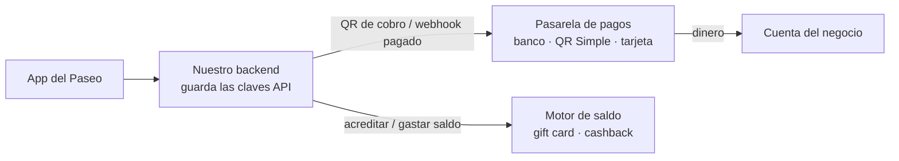
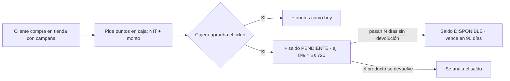
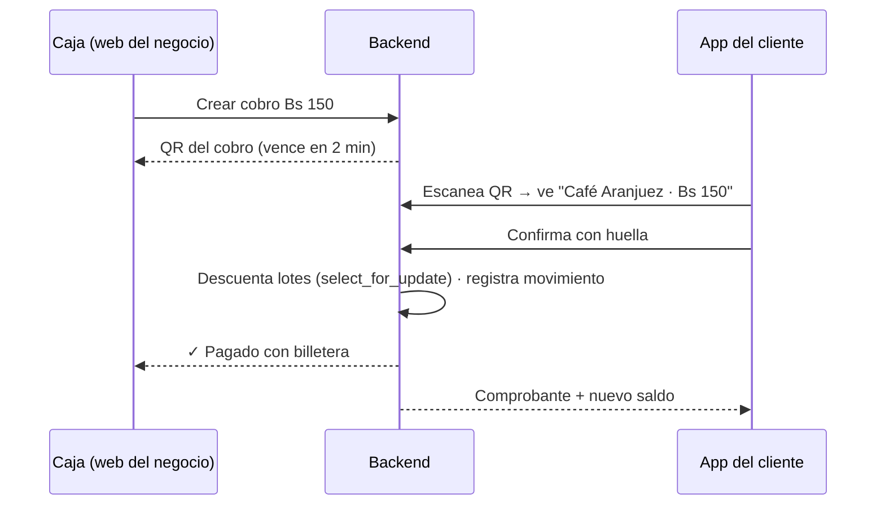

# Billetera Paseo (saldo de regalo)

> **Idea:** además de los Paseo Points, cada cliente tiene una **billetera con saldo en Bs** que **solo se gasta dentro del Paseo**. El saldo lo regala el Paseo (o la tienda) como **devolución de un porcentaje** de una compra.
> Ejemplo: compra un iPhone de Bs 9.000 en una tienda con campaña del 8 % → recibe **Bs 720 de saldo** para gastar en otras tiendas, comida o cine del Paseo.

## ✅ Decisión 2026-10-18: no manejamos el dinero ni la seguridad
**El dinero y el saldo los manejan proveedores externos; nuestra app es solo la pantalla.** El cliente ve su saldo, paga y recibe su devolución dentro de la app del Paseo, pero:

| Pieza | Quién la maneja | Qué hacemos nosotros |
|---|---|---|
| **Cobro con dinero real** (QR del banco y tarjeta) | **Pasarela de pagos boliviana** o API QR de un banco: el dinero va **directo de la cuenta del cliente a la del negocio** | Pedir el QR por API, mostrarlo en la app y recibir el aviso "pagado" (webhook) |
| **Saldo de regalo** (devolución %, vencimiento, presupuesto, topes) | **Motor de fidelización/gift cards por API** (ej. Voucherify o Talon.One): ellos guardan el saldo y el historial | Mostrar el saldo, pedirles "acredita Bs 720" al aprobar la compra y "descuenta Bs 150" al pagar |
| Puntos (Paseo Points) | Nosotros, como hoy | Nada nuevo |

**Así no tocamos:** datos de tarjetas, dinero de terceros, conciliación bancaria ni el libro de saldos. La app **nunca** habla directo con el proveedor: las claves quedan en nuestro backend.

**Pago de un pedido de Bs 900 con Bs 720 de saldo:** la app pide aplicar el saldo → el motor descuenta Bs 720 → la pasarela genera un QR por los Bs 180 restantes → llega el webhook "pagado" → pedido pagado. Si el QR vence, se pide al motor devolver los Bs 720.

**Por confirmar (llamar o escribir a cada uno):**
- Pasarela: qué proveedores o bancos bolivianos dan **API + webhook** de cobro QR para un marketplace con muchos negocios (cada tienda recibe en su propia cuenta), con autorización ASFI, comisiones y tiempos de alta. Candidatos a consultar: pasarelas locales y las APIs QR de los bancos con que ya trabaja el Paseo.
- Motor de saldo: precio (suelen ser planes empresariales), si manejan **Bs** y si el plan de prueba alcanza para la demo.
- Abogado: que el saldo de regalo, no retirable y solo para el Paseo, no se considere dinero electrónico.

> Las secciones de abajo (modelo de datos, antifraude) eran para **construirlo nosotros**; quedan como **plan B** si los proveedores no sirven o salen caros. Las reglas comerciales (campañas, "no gastar en la misma tienda", vencimiento) siguen valiendo: se configuran en el motor.

## 💵 Opción: saldo atado al dólar / USDT (2026-10-18)
El boliviano se mueve mucho frente al dólar: el **oficial del BCB** pasó de Bs 6,96 a **Bs 11,69** (vigente 17–19 oct 2026) y el **USDT P2P** estaba en **Bs 11,81–11,86** el mismo día. Un regalo de "Bs 720" pierde valor; un regalo de **"USD 100"** no.

**Opción A — sin pasarela ni cripto (recomendada para empezar):**
- El saldo de regalo se guarda **en USD**, porque es dinero de marketing y no hay que mover cripto de verdad.
- La app lo muestra en Bs con la **cotización del día** ("USD 100 ≈ Bs 1.030 hoy").
- Al pagar se **congela la cotización** de ese momento y se guarda en el movimiento (USD, Bs y la tasa usada). Con eso se liquida a la tienda en Bs, sin discusiones.
- Solo hace falta una **fuente de cotización** por API, consultada cada X minutos y guardada en historial. Hay que **decidir cuál**: oficial del BCB, referencial del BCB o promedio P2P USDT/BOB.
- ⚠️ Decisión comercial: con una tasa paralela, la tienda que recibe el pago cobra más Bs por cada dólar de regalo. El financiador (Paseo o tienda) **absorbe la devaluación**. Conviene un tope en USD por campaña.

**Opción B — pagos reales en USDT con otra empresa (sin pasarela clásica):**
- El cliente paga desde **su** billetera o exchange y el dinero llega a la cuenta del negocio. Nosotros **nunca custodiamos** cripto.
- Candidatos a consultar: bancos con cuentas USDT (**Banco Bisa** custodia USDT desde oct 2024, **Banco FIE** "Cuenta Cripto" desde abr 2026, **Banco Unión** con límite diario), **Bybit Pay**, que paga QR de Yape con cripto (mar 2026), y proveedores registrados como **PSAV ante la ASFI** (Res. ASFI 540/2025).
- La regulación todavía cambia: el gobierno evalúa que el USDT circule "como otra moneda", pero aún no es una regla vigente. **Validar con un abogado** antes de lanzar.

## Qué es y qué NO es
| Es | No es |
|---|---|
| **Saldo cerrado** (como una gift card del Paseo): se usa solo en negocios del Paseo | Una pasarela de pagos ni un banco |
| Se paga desde la app (QR de la caja + huella) o en pedidos de PaseoYa | Dinero que se puede retirar, transferir a otra persona o cobrar en efectivo |
| Dinero de marketing: lo pone el Paseo o la tienda que vende | En la fase 1, dinero que el cliente carga desde su banco |
| Convive con los **puntos** (que siguen igual) | Un reemplazo de las monedas |

**Puntos vs. billetera:** los puntos se canjean por **recompensas** del catálogo ([[Monedero y recompensas]]). La billetera son **Bs reales** que pagan cualquier compra en tiendas adheridas. Una compra puede dar las dos cosas a la vez.

> ⚖️ **Por qué la fase 1 no acepta recargas con dinero del cliente:** guardar dinero de terceros y usarlo como medio de pago es dinero electrónico, y en Bolivia está regulado (ASFI / BCB). El saldo **regalado**, no reembolsable y que se gasta solo en el Paseo, se parece más a un cupón o una gift card promocional. **Confirmar con un abogado antes de lanzar**, sobre todo antes de la fase 3.

## Cómo funciona
### 1. Ganar saldo (devolución)

- Se engancha a la **SolicitudPuntos** que ya existe: el mismo ticket aprobado da puntos y saldo. No hay un flujo nuevo para el cajero.
- **Saldo pendiente** unos días (ej. 7) para cubrir devoluciones: si devuelve el iPhone, no se queda con los Bs 720.
- Cada entrega es un **lote** con su vencimiento; al pagar se gasta primero el lote que vence antes.

### 2. Pagar con la billetera en una tienda

- **Pago mixto:** si el saldo no alcanza, se paga una parte con billetera y el resto como siempre (efectivo, tarjeta o QR del banco).
- En **PaseoYa**: en "Esperando pago" se agrega **"Pagar con mi billetera"** junto al QR del banco.
- **Liquidación:** al Café Aranjuez le pagan los Bs 150 quien financió ese saldo (el Paseo o la tienda de la campaña). Hay un reporte de liquidación por negocio y por periodo.

### 3. Campañas (admin y, más adelante, cada tienda)
| Campo | Ejemplo |
|---|---|
| Quién la financia | Paseo / tienda emisora / 50-50 |
| Tienda(s) o rubro donde se gana | iStore, rubro Tecnología |
| Porcentaje o monto fijo | 8 % · o Bs 100 fijos |
| Compra mínima / tope por compra | desde Bs 500 · máximo Bs 800 |
| Presupuesto total | Bs 20.000 (se corta al agotarse) |
| Dónde se puede gastar | todo el Paseo · solo comida · **no en la misma tienda** |
| Vigencia y vencimiento del saldo | 1–31 nov · el saldo vence a los 90 días |
| Días de saldo pendiente | 7 |

> Que el saldo **no se pueda gastar en la misma tienda** es la gracia comercial: el cliente que compra un iPhone termina comiendo y yendo al cine en el Paseo.

## 🧪 Simulación en la app (2026-10-18)
Inicio → **"Billetera Paseo · simulación"** (solo clientes). Es solo frontend: no llama al backend ni mueve dinero, y se borra al cerrar la app.
- Usa los **negocios reales** del directorio (ej. iPhone en **APPLE LAND**) y las reglas de este plan (8 %, tope USD 100, compra mínima Bs 500, 7 días pendiente, vence a los 90 días, no se gasta en la misma tienda).
- Cotización **real**, sin números fijos: `GET /api/v1/billetera/cotizaciones/` (`backend/fidelizacion/cotizaciones.py`).
  - Oficial: se lee de la portada de https://www.bcb.gob.bo/ (el BCB no tiene API).
  - USDT: mediana de 10 anuncios de compra y 10 de venta del P2P de Binance; se usa el promedio.
  - Caché de 30 min. Si una fuente falla se muestra el último valor bueno con aviso; si nunca respondió, la app bloquea pagar y simular compra (no inventa).
  - ⚠️ Si el BCB cambia el diseño de su portada, hay que ajustar la lectura (las pruebas lo detectan con un HTML de ejemplo).
- Flujos: simular compra aprobada → saldo pendiente → "+7 días" → pagar en caja o en pedido de Comer con huella → comprobante. Pago parcial con el resto por QR. Simular una devolución (anula el saldo) y el vencimiento.
- Archivos: `app/screens/BilleteraScreen.js` y `app/services/billeteraSimulada.js` (reglas en centavos enteros, para pasarlas tal cual al backend o al proveedor).

## Pantallas
**📱 App (cliente)**
- Inicio: tarjeta **"Billetera Bs 720"** junto a las monedas, con "Bs 120 vencen en 5 días".
- Billetera: disponible / pendiente / por vencer, historial y **Pagar** (abre el escáner).
- Escáner: si el QR es un cobro, muestra negocio y monto y confirma con huella.
- PaseoYa: botón "Pagar con mi billetera".
- Jarvis: "¿cuánto saldo tengo?" y "¿dónde lo puedo gastar?".

**🏪 Web (negocio)**
- Caja: **Cobrar con billetera** (monto → QR → "✓ Pagado"). Reversar un cobro el mismo día.
- Liquidaciones: lo que el Paseo le debe por pagos con billetera.

**🖥️ Web (admin)**
- Campañas: crear, pausar y ver el presupuesto usado.
- Resumen: **saldo emitido, gastado, vencido y vigente** (lo que el Paseo "debe").
- Liquidaciones por negocio (CSV/Excel) y su registro en [[Dashboard admin]] y Auditoría.

## Modelo de datos — plan B, solo si lo construimos nosotros (nueva app `billetera`)
> Con proveedores externos solo guardamos: el **ID del cliente en el motor**, la **referencia del pago** de la pasarela en el `Pedido` y un registro de los webhooks recibidos.
| Modelo | Para qué |
|---|---|
| `Billetera` | Una por cliente; saldo disponible y pendiente en caché (la verdad está en los movimientos) |
| `Campania` | Las reglas de la tabla de arriba |
| `LoteSaldo` | Cada entrega: monto, restante, campaña, financiador, `disponible_desde`, `vence_en` |
| `MovimientoBilletera` | Libro **inmutable**: `CASHBACK`, `PAGO`, `REVERSO`, `VENCIMIENTO`, `ANULACION`, `AJUSTE` (y `RECARGA` en la fase 3) |
| `Cobro` | Cobro creado por la caja: empresa, monto, código del QR, vence en 2 min, estado |
| `Liquidacion` | Lo que se debe a cada negocio por periodo y su estado (pendiente → pagado) |

Reglas técnicas: siempre `Decimal` (nunca float); `select_for_update` y `transaction.atomic` en cada pago; **clave de idempotencia** en el cobro (un doble toque no cobra dos veces); el vencimiento lo hace un comando diario (`vencer_saldos`).

## Antifraude
- El saldo nace **solo de un ticket aprobado por el cajero** (igual que los puntos) y queda pendiente unos días.
- Tope por compra y por cliente al mes; los montos grandes (ej. > Bs 3.000) los revisa el admin.
- Cada pago se confirma con **huella** y el QR del cobro vence en 2 minutos.
- Sin transferencias entre clientes ni retiro en efectivo (fase 1).
- Una tienda no puede darse saldo a sí misma: no hay cobro sin una venta real en otra tienda.
- Todo queda en Auditoría. Ver [[Seguridad]].

## Fases
| Fase | Incluye | Estimado |
|---|---|---|
| **0 · Elegir proveedores** | Consultar pasarela, motor de saldo y abogado (ver "Por confirmar") · crear cuentas de prueba (sandbox) | días, depende de ellos |
| **1 · MVP (demo)** | Conectar el sandbox: saldo al aprobar ticket · pagar en caja con QR + huella · pagar PaseoYa (saldo + QR por el resto) · historial · resumen del admin | ~1 semana (menos que construirlo) |
| **2 · Comercial** | Campañas creadas por cada tienda con su presupuesto · pago mixto · "no gastar en la misma tienda" · avisos de vencimiento (push) · canjear puntos → saldo | 1–2 semanas |
| **3 · Dinero real** | Recargas con QR del banco o tarjeta mediante una pasarela local · gift cards para regalar · **solo con revisión legal previa** | a definir |

## ❓ Decisiones abiertas (para el equipo)
1. **¿Quién paga el regalo?** El Paseo, la tienda que vende o mitad y mitad. Con esto se definen la liquidación y quién crea campañas.
2. **Porcentaje y topes** de la primera campaña (ej. 5–10 %, máximo Bs 800).
3. **¿Se puede gastar en la misma tienda** que lo dio?
4. **Vencimiento** del saldo (60 / 90 / 180 días) y **días pendiente** por devoluciones.
5. **Moneda:** todo en **Bs** (los precios del Paseo están en Bs). Mostrar USD solo como referencia, si se quiere.
6. **¿Se pueden convertir puntos en saldo?** (ej. la recompensa "Bs 50 de descuento" pasaría a ser saldo de la billetera).
7. **¿Cada cuánto se liquida** a los negocios (semanal, mensual)?

Ver también: [[Fidelización]] · [[Comer y pedidos (PaseoYa)]] · [[Modelo de datos]] · [[Pendientes]]
