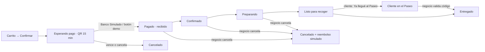

# Comer y pedidos (PaseoYa)

Marketplace de comidas: el cliente ve los menús, pide desde la app y **recoge en el local** con un código (no hay delivery).

## Flujo completo con pago QR (2026-10-04 · Reto 3 del PDF)
**Sin delivery: retiro presencial obligatorio** (condición central del reto). Solo **negocios de comida**.



0. **Se puede pedir desde dos lugares**: la sección **Comer** (todos los menús) o la **ficha del restaurante** (sección "Menú" con + / −). Mismo carrito, mismo pago (`components/FlujoPedido.js`).
0. **Comprar o reservar** (2026-10-04): en el carrito "¿Cuándo lo retiras?" → **Lo antes posible** o **Reservar hora** (hoy, mañana o pasado mañana, cada 30 min entre 09:00 y 22:00; mínimo 20 min de anticipación, máximo 3 días). Se paga al reservar. La app muestra "Reservado para retirar hoy 12:30" y el panel "⏰ Reserva: retira dom 4, 12:30".
1. **App (cliente)** → carrito → **Confirmar pedido** / **Pagar y reservar** → se crea en **Esperando pago** con un **QR de cobro** (vence en 15 min, cuenta regresiva).
2. **Pago simulado de banco**: el QR abre `/pago-simulado/<referencia>/` (página "Banco Simulado": comercio, monto, referencia, botón **Pagar**). Se escanea con la cámara de otro celular (misma red) o se usa **"Simular pago (demo)"** en la app. La app detecta el pago sola (consulta cada 3 s) → "¡Pago recibido!" + código de retiro.
3. **Web (negocio)** → Pedidos (Comer): mientras no pague ve "Esperando el pago (no prepares todavía)", sin botones. Pagado: "✓ Pagado con QR · hora" → **Confirmar → Empezar a preparar → Marcar listo**.
4. **App** → Mis pedidos: línea de estados **Pagado → Confirmado → Preparando → Listo → En el Paseo → Entregado**; con el pedido listo aparece **"Ya llegué al Paseo"** y el **QR/código de retiro**.
5. **Web**: la fila se pinta de verde "¡El cliente está en el Paseo! Pídele su código" → el negocio escribe el código → **Entregado** (cuenta en "Entregados hoy" y "Facturado hoy").
6. Ambos lados se actualizan solos: app cada 5 s, panel web cada 6 s.

> Reserva probada desde la ficha de Waffle King: 2 waffles, Bs 62, reservado para hoy 12:30, pago demo, visible en app y panel (pedido de prueba borrado). Se cobra el **precio de promoción** si el plato está en promoción.
> Probado de punta a punta en Chrome (2026-10-04): Waffle King, Bs 48, pago por la página del banco simulado, estados reflejados en app y panel, entregado con el código. Pedido de prueba borrado. 28 pruebas de pedidos (6 nuevas).

## Quién ve qué
- **Cliente (app)**: Mis pedidos, con **Pagar con QR** y **Cancelar** mientras no haya pagado (2026-10-04).
- **Negocio (web)**: solo los pedidos de su local, con el estado en vivo.
- **Administrador (web)**: **Pedidos y retiros** (`/pedidos`, 2026-10-04): todos los pedidos de todos los negocios, resumen por estado y lo vendido, filtros por estado y buscador, se actualiza solo cada 6 s. Cumple "Supervisar pedidos" del PDF (5.7). API: `admin/pedidos/` y `admin/pedidos/resumen/`.

## Menús de los 23 restaurantes
- **93 platos** cargados desde `backend/empresas/datos/menus_paseo.json`.
- Los platos salen del rubro que cada local publica en paseoaranjuez.com.
- ⚠️ **Precios referenciales** (no publicados por los locales): calibrados con almuerzo con bebida ≈ Bs 51 y cerveza ≈ Bs 18 en Cochabamba (expatistan.com). Cada negocio los corrige desde su panel.
- Fotos: 49 platos usan fotos reales de la galería del local (repartidas por turnos, **no es la foto del plato exacto**); el resto muestra el logo.

```bash
python manage.py cargar_menus_paseo   # después de importar_tiendas_paseo
```

## En la app (`ComerScreen`)
- Carrusel de logos para filtrar por local · buscador · grilla con foto, local, piso y precio.
- Primero los platos con foto real.
- **Carrito** (2026-10-04): barra inferior con cantidad, total y "Ver carrito" → hoja con cada plato (foto, precio c/u, − / +, subtotal, quitar), "Vaciar carrito", total y **Confirmar pedido**. Antes solo había un total y la confirmación usaba alertas del sistema que **no funcionaban en Expo web**.
- El carrito **no se pierde** al cambiar de pantalla (`context/CarritoContext.js`); se vacía al cambiar de cuenta.
- Un pedido = un solo local: si agregas de otro local, aviso con diseño ("Mantener" o "Vaciar y agregar").
- Probado en Chrome: 2 × Bowl clásico + 1 × frutos rojos en Açaí Golden → Bs 112, código de retiro (pedido de prueba borrado).
- Pestaña **Mis pedidos** con estado y código.

## API
| Ruta | Quién | Uso |
|---|---|---|
| `GET /api/v1/productos/?rubro=comida&empresa=&buscar=` | público | catálogo con logo y piso del local |
| `POST /api/v1/pedidos/` `{empresa, items:[{producto_id, cantidad}]}` | cliente | crear pedido |
| `GET /api/v1/pedidos/` | cliente | mis pedidos |
| `POST /api/v1/pedidos/{id}/simular-pago/` · `cancelar/` · `llegue/` | cliente | pagar (demo), cancelar sin pagar, avisar llegada |
| `GET/POST /pago-simulado/<referencia>/` | público | página del Banco Simulado que abre el QR |
| `GET /api/v1/mi-empresa/pedidos/` · `avanzar/` · `cancelar/` · `validar-retiro/` | negocio (web) | panel |

## Pendiente
- Notificación push cuando el pedido está listo (hoy solo se entera con la app abierta).
- Pago real con un banco (QR simple de un banco boliviano) en lugar del simulado.
- Dar Paseo Points automáticamente al entregar un pedido (integración pedida en el PDF, sección 6).
- Fotos reales por plato (las sube cada negocio).

## Archivos clave
`backend/pedidos/` · `backend/empresas/views.py` (`ProductoPublicoViewSet`) · `app/screens/ComerScreen.js` · `app/components/CarritoSheet.js` · `app/context/CarritoContext.js` · `app/services/pedidosService.js` · `web/src/empleado/api/pedidos.ts`

Relacionado: [[Directorio y rubros]] · [[Jarvis (asistente IA)]] · [[Decisiones]]
