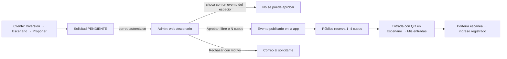

# Escenario abierto

Un sector donde **cualquier cliente propone su presentación** (tocar guitarra, un podcast en vivo, un taller, una charla…), el **admin la aprueba según disponibilidad** y se publica como evento con **acceso libre** o **con cupos** que el público reserva desde la app. Cada reserva da una **entrada con QR** que se guarda en la app y se valida en la puerta.

## Flujo

## Formulario de la app
Tipo (música en vivo, podcast o charla, arte y cultura, taller, otro) · **nombre artístico o del grupo** · **nombre de la presentación** · **para cuántas personas** · espacio · **día** (próximos 30) · hora de inicio · duración (1–4 h) · acceso que prefiere (libre o cupos) · **descripción** · **qué va a necesitar**.

## Reglas
- Con **al menos 1 día de anticipación**; máximo 6 h; el público no puede superar la capacidad del espacio.
- Máximo **3 solicitudes en revisión** por persona; puede retirarlas mientras estén pendientes.
- No se puede pedir ni aprobar un horario que **choca con un evento del mismo espacio**. El panel avisa también si otras solicitudes piden el mismo horario.
- Al aprobar, el admin decide **acceso libre o cupos** (y cuántos, hasta la capacidad) y si sale **destacado** en el Inicio.
- Reserva: 1 por persona y evento (de 1 a 4 cupos); se puede cancelar y el cupo vuelve a quedar libre.
- Puerta: la entrada vale desde 2 h antes del inicio hasta el fin del evento, **una sola vez**.
- Avisos por correo: al admin (solicitud nueva) y al solicitante (aprobada o rechazada con motivo). En desarrollo salen en la terminal del backend.

## Espacios (cargados con `importar_agenda_paseo`)
| Espacio | Ubicación | Capacidad* |
|---|---|---:|
| Escenario de El Club | El Club by Mercado Gastronómico, piso 3 | 120 |
| Escenario del Cinema Lounge | Mercado Gastronómico, piso 3 | 40 |
| Rincón acústico de El Cuarto | El Cuarto by Paseo, piso 4 | 80 |
| Galería de Arte | Piso 3 | 60 |

\* Espacios reales mencionados en la fuente; **capacidades estimadas**. El admin las edita en la web.

## Dónde está
| Parte | Qué |
|---|---|
| App · Diversión → **Escenario** | Proponer, **Mis entradas** (QR), Mis solicitudes con su estado, espacios disponibles |
| App · detalle del evento | Barra de cupos ("2 de 3 reservados"), reservar, entrada con QR, "Escenario abierto · presenta …" |
| App · Portería | Escanea `paseo360://evento/<código>` y registra el ingreso |
| Web admin · **Escenario abierto** (`/escenario`) | Bandeja Pendientes/Aprobadas/Rechazadas con choques de horario, aprobar (libre o cupos), rechazar con motivo, gestión de espacios |
| Web admin · Promociones y eventos | Los eventos ahora tienen **cupos** y **espacio**; columna "reservados/cupos" |
| Jarvis | Sabe si un evento es libre o con cupos, cuántos quedan y quién lo presenta |

## API
| Ruta | Quién |
|---|---|
| `GET entretenimiento/espacios/` | público |
| `GET/POST entretenimiento/propuestas/` · `POST …/{id}/cancelar/` | cliente |
| `GET/POST entretenimiento/entradas/` `{evento, cantidad}` · `POST …/{id}/cancelar/` | cliente |
| `admin/propuestas/?estado=` · `POST …/{id}/aprobar/` `{acceso, cupos, destacado}` · `POST …/{id}/rechazar/` `{motivo}` | admin |
| `admin/espacios/` (CRUD) · `GET admin/eventos/{id}/asistentes/` | admin |
| `GET/POST porteria/entradas-evento/<código>/` (validar / registrar ingreso) | portero o admin |

## Probado (2026-10-04)
Flujo completo en Chrome: propuesta desde la app → aparece en el panel con datos del solicitante → aprobada con 3 cupos → publicada ("3 cupos libres") → reserva de 2 cupos con QR → "Mis entradas" y "2 de 3 cupos reservados". 6 pruebas automáticas del flujo (164 en total, todas OK). Los datos de prueba se borraron.

## Archivos clave
`backend/entretenimiento/escenario.py` (reglas) · `models.py` (`Espacio`, `Propuesta`, `ReservaEvento`, `Evento.cupos/espacio`) · `views.py` · `app/components/Escenario.js` · `app/screens/DiversionScreen.js` · `app/screens/PorteriaScreen.js` · `web/src/paseo360/pages/Escenario.jsx`

Relacionado: [[Diversión (cartelera y eventos)]] · [[Dashboard admin]] · [[Pendientes]]
