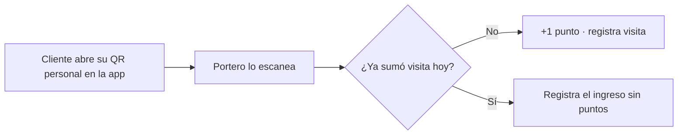
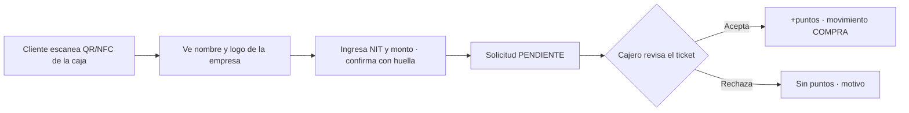

# Fidelización (Paseo Points)

Dos formas de ganar puntos: **visitar** el Paseo y **comprar** en sus negocios.

## 1. Puntos por visita (portería)

- El **QR personal es dinámico**: firmado y **vence en 2 minutos** (la app lo renueva). Una captura enviada a otra persona no sirve.
- El portero ve el **nombre del cliente** al escanear.
- Configurable por el admin: `puntos_por_visita` (1) y `visitas_con_puntos_por_dia` (1).

## 2. Puntos por compra (caja)

- Regla: **Bs 1 = 1 punto** (configurable, redondea hacia abajo).
- Los puntos se acreditan **solo al aprobar**, y una sola vez.
- Un cajero solo ve y aprueba solicitudes **de su empresa**.

## Reglas antiabuso (compras)
- Una solicitud **pendiente** por cliente y empresa.
- Máximo **3 solicitudes por día** en la misma empresa (configurable).
- **Monto máximo** por solicitud: Bs 5.000 (configurable).
- QR de oficinas no suma puntos.
- QR de caja regenerable.

## Movimientos
Cada suma o resta queda en `MovimientoPuntos` con tipo `VISITA`, `COMPRA` o `CANJE`. El saldo vive en `Usuario.puntos_saldo`.

Ver también: [[Monedero y recompensas]] · [[Seguridad]] · [[API]]
