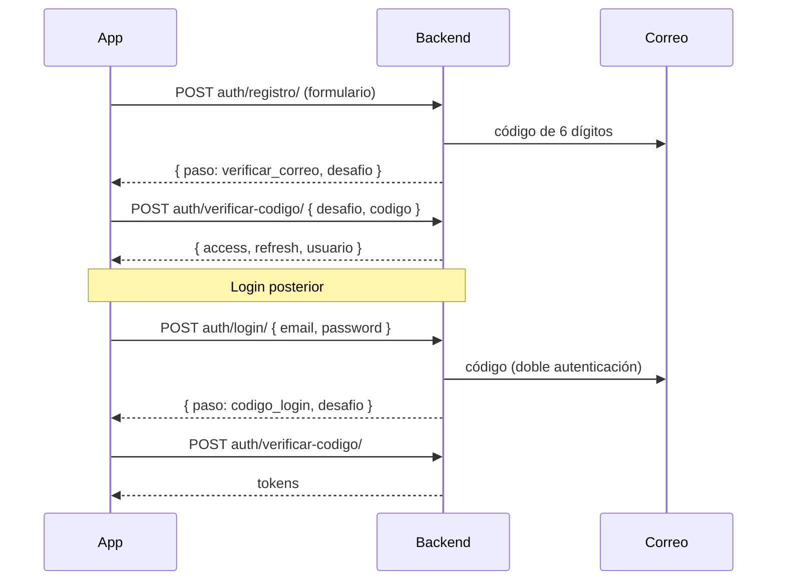

# Registro y acceso

## Formulario de registro (app)
| Sección | Campos | Validación |
|---|---|---|
| Datos personales | Nombre, apellido, fecha de nacimiento (opcional → bono de cumpleaños) | |
| Contacto | **Correo** y **celular** separados | celular boliviano: 8 dígitos, empieza con 6 o 7 (acepta `+591`) |
| Identidad | **CI obligatorio** · NIT opcional | CI: 5–10 dígitos + complemento opcional (`1234567-1A`), único. Aviso: *"Tu carnet debe ser real y válido: te lo pediremos para entregarte premios y canjes."* |
| Seguridad | Contraseña + confirmación | ≥ 8 caracteres, letras y números; indicadores en verde mientras se escribe |
| Términos | Interruptor obligatorio | se guarda la fecha de aceptación |

Correo y CI no se pueden repetir. El NIT se usará por defecto al registrar compras en caja.

## Flujo

- **No existe login sin código** (se eliminó `/auth/token/`).
- Cuentas creadas por el admin: en su primer login el código verifica su correo.

## Protecciones del código
- 6 dígitos, se guarda solo un **HMAC** (nunca en claro).
- Vence en **10 minutos**, **5 intentos** máximo.
- Reenviar: esperar **60 s**; el anterior deja de servir.
- Límite de **20 intentos/min** en registro y login.

## Acceso directo (huella / Face ID)
- Tras el primer ingreso la app pregunta si activar la huella.
- La sesión (refresh token, 30 días) queda en **SecureStore**; al abrir la app se desbloquea con la huella, sin contraseña ni código.
- "Entrar con correo y contraseña" borra la sesión guardada.

## Archivos clave
- Backend: `usuarios/verificacion.py`, `usuarios/views.py`, `usuarios/serializers.py`, `usuarios/validators.py`
- App: `screens/RegistroScreen.js`, `VerificarCodigoScreen.js`, `DesbloqueoScreen.js`, `services/biometria.js`, `context/UserContext.js`
- Web: `src/pages/Login.jsx`

> [!tip] En desarrollo los correos (y códigos) se imprimen en la **terminal del backend**. Ver [[Problemas comunes]].
