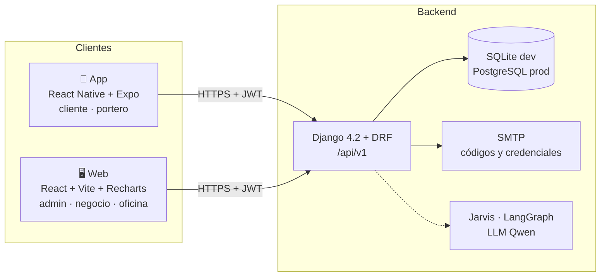

# Arquitectura

## Backend (`backend/`)
| App Django | Responsabilidad |
|---|---|
| `usuarios` | Usuario con rol, registro, login con doble autenticación, códigos, porteros, lista de usuarios admin |
| `empresas` | Empresas, categorías, horarios, productos, ofertas, QR/NFC; comandos `cargar_demo` y `cargar_actividad_demo` |
| `fidelizacion` | Configuración de puntos, solicitudes de compra, visitas, movimientos, recompensas, monedero |
| `reportes` | Estadísticas del [[Dashboard admin]] |
| `pedidos` | Pedidos de Comer (PaseoYa) con código de retiro |
| `entretenimiento` | Películas, funciones, reservas de cine, eventos; Escenario abierto (espacios, propuestas, cupos con QR); importador de la agenda real |
| `oficinas` | Invitaciones/visitas a oficinas y validación en portería |
| `agente` | Jarvis: contexto con datos reales, acciones con confirmación. Necesita un LLM con cuota (`LLM_PROVIDER` en `.env`) |

Patrón: lógica de negocio en `services.py` (no en las vistas), permisos por rol en `usuarios/permissions.py`, pruebas en `tests.py` de cada app (**164 pruebas**, todas OK al 2026-10-04).

## Web (`web/`)
Vite con **proxy** de `/api`, `/auth` y `/media` al backend (sin problemas de CORS). Tokens en `sessionStorage`. Páginas en `src/pages/`.

## App (`app/`)
Expo SDK 57, React Navigation (stack según estado de sesión: cargando / bloqueado / invitado / autenticado). Axios con renovación automática del token. Tokens en **SecureStore**. Variable `EXPO_PUBLIC_API_BASE`.

## Autenticación
JWT (SimpleJWT): access 60 min, refresh 30 días. Login siempre con código por correo → [[Registro y acceso]].

## Stack
Python 3.11 · Django 4.2 · DRF 3.16 · SimpleJWT · Pillow · Node 22 · React 19 · Vite 8 · Recharts 3 · Expo 57 · React Native 0.86.

Ver [[API]] · [[Modelo de datos]] · [[Despliegue VPS]]
