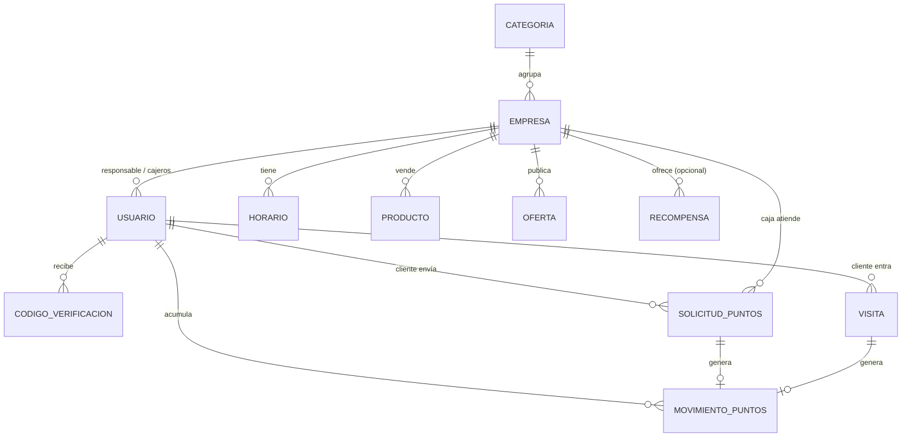

# Modelo de datos

## Tablas principales
| Modelo | Campos clave |
|---|---|
| **Usuario** | rol, empresa, email, celular, **ci** (único), nit, fecha_nacimiento, email_verificado, acepto_terminos_en, **puntos_saldo**, debe_cambiar_password |
| **CodigoVerificacion** | desafio (UUID), proposito (VERIFICAR_EMAIL / LOGIN), codigo_hash, expira_en, intentos, usado |
| **Empresa** | nombre, tipo (NEGOCIO/EMPRENDIMIENTO/OFICINA), categoria, email_contacto, piso, local, referencia, logo, activo, **codigo_fidelizacion** |
| **Horario** | empresa, dia (0–6), abre, cierra, cerrado |
| **Producto** | empresa, nombre, precio, foto, activo |
| **Oferta** | empresa, producto?, titulo, precio_oferta, inicio, fin |
| **ConfiguracionPuntos** (1 fila) | puntos_por_boliviano, monto_maximo_solicitud, solicitudes_diarias_por_empresa, puntos_por_visita, visitas_con_puntos_por_dia |
| **SolicitudPuntos** | cliente, empresa, nit, monto, estado (PENDIENTE/APROBADA/RECHAZADA), puntos, atendida_por, motivo_rechazo |
| **Visita** | cliente, portero, puntos |
| **MovimientoPuntos** | cliente, empresa?, solicitud?, visita?, puntos (+/−), tipo (COMPRA/VISITA/CANJE) |
| **Recompensa** | nombre, costo_puntos, empresa?, imagen, activo |
| **Canje** | cliente, recompensa, código del cupón, estado (validado en caja) |
| **RangoCompra** · **PuntoEscaneo** | tramos de puntos por monto · puntos NFC/QR de puerta y actividades |
| **Pedido** · **PedidoItem** | cliente, empresa, estado, código de retiro · productos y cantidades |
| **Pelicula** · **Funcion** · **ReservaCine** | póster, clasificación · inicio, sala, precio · entradas con monedas o boletería |
| **Evento** | categoría, inicio/fin, lugar, imagen, precio (0 = libre), destacado, **cupos** (vacío = acceso libre), **espacio** |
| **Espacio** | nombre, lugar, capacidad, equipamiento → [[Escenario abierto]] |
| **Propuesta** | solicitante, espacio, artista, título, tipo, descripción, necesidades, inicio/fin, personas, acceso, estado, motivo, evento publicado |
| **ReservaEvento** | evento, cliente, cantidad, código (QR), estado, ingreso_en |
| **Invitacion** (oficinas) | oficina, visitante, fecha, código, ingreso |

## Pendientes de modelar
Cajeros gestionados por la empresa · niveles (Bronce/Plata/Oro) · notificaciones push. Ver [[Pendientes]].
