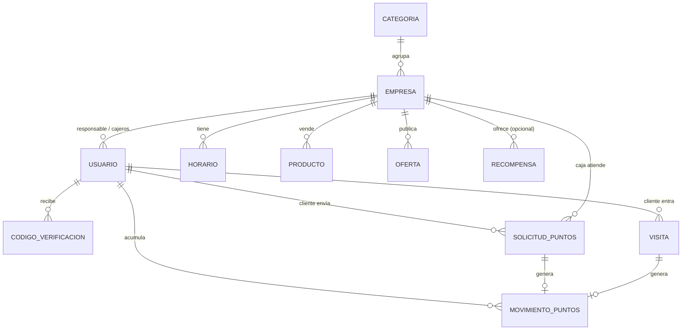

# Modelo de datos

## Tablas principales
| Modelo | Campos clave |
|---|---|
| **Usuario** | rol, empresa, email, celular, **ci** (único), nit, fecha_nacimiento, email_verificado, acepto_terminos_en, **puntos_saldo**, debe_cambiar_password |
| **CodigoVerificacion** | desafio (UUID), proposito (VERIFICAR_EMAIL / LOGIN), codigo_hash, expira_en, intentos, usado |
| **Empresa** | nombre, tipo (NEGOCIO/EMPRENDIMIENTO/OFICINA), categoria, email_contacto, piso, local, referencia, logo, activo, **codigo_fidelizacion** |
| **Horario** | empresa, dia (0–6), abre, cierra, cerrado |
| **Producto** | empresa, nombre, precio, foto, activo |
| **Oferta** | empresa, producto?, titulo, precio_oferta, inicio, fin |
| **ConfiguracionPuntos** (1 fila) | puntos_por_boliviano, monto_maximo_solicitud, solicitudes_diarias_por_empresa, puntos_por_visita, visitas_con_puntos_por_dia |
| **SolicitudPuntos** | cliente, empresa, nit, monto, estado (PENDIENTE/APROBADA/RECHAZADA), puntos, atendida_por, motivo_rechazo |
| **Visita** | cliente, portero, puntos |
| **MovimientoPuntos** | cliente, empresa?, solicitud?, visita?, puntos (+/−), tipo (COMPRA/VISITA/CANJE) |
| **Recompensa** | nombre, costo_puntos, empresa?, imagen, activo |

## Pendientes de modelar
Canje/Cupón · Invitación de oficina · Evento · Puerta de entrada en Visita. Ver [[Pendientes]].
